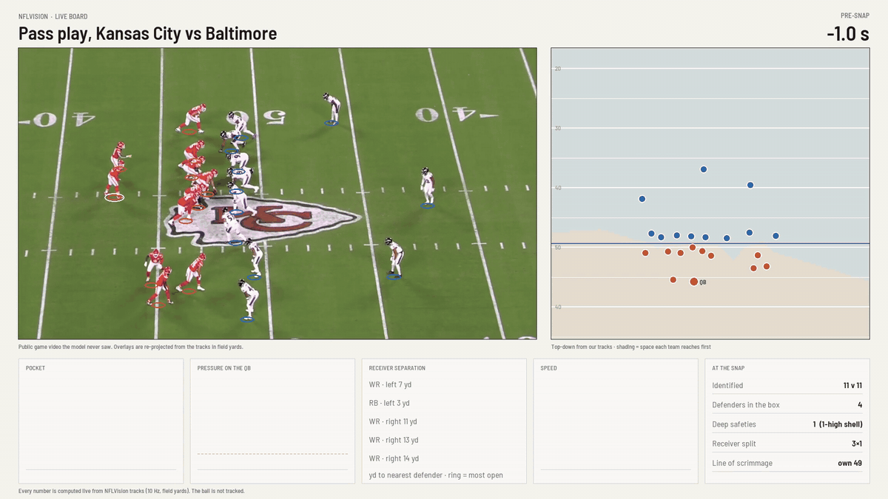
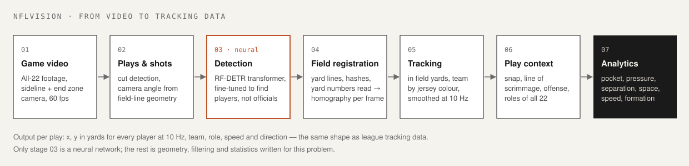
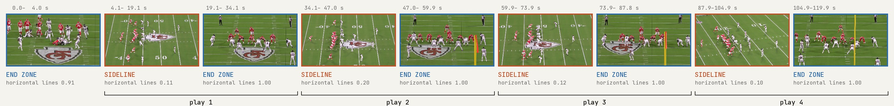
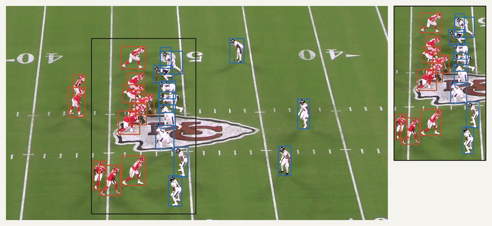
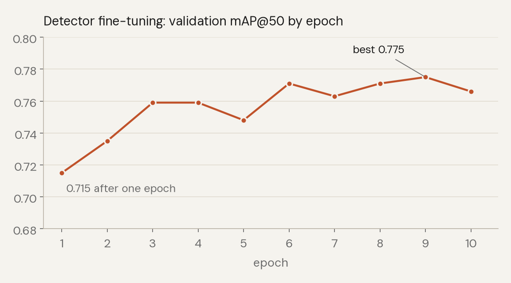
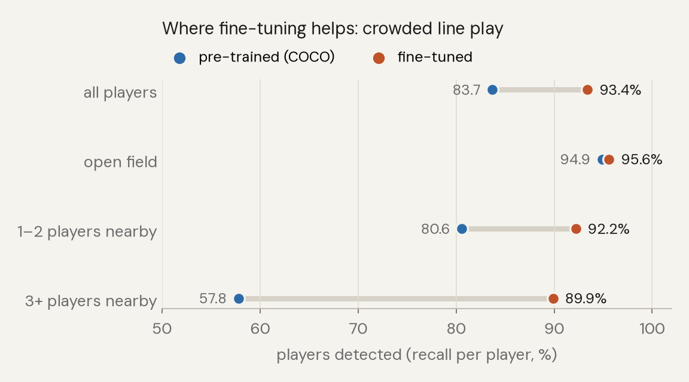
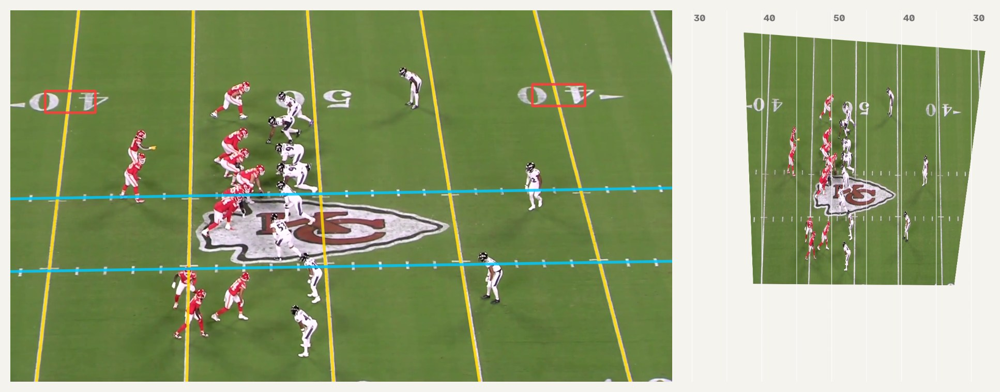
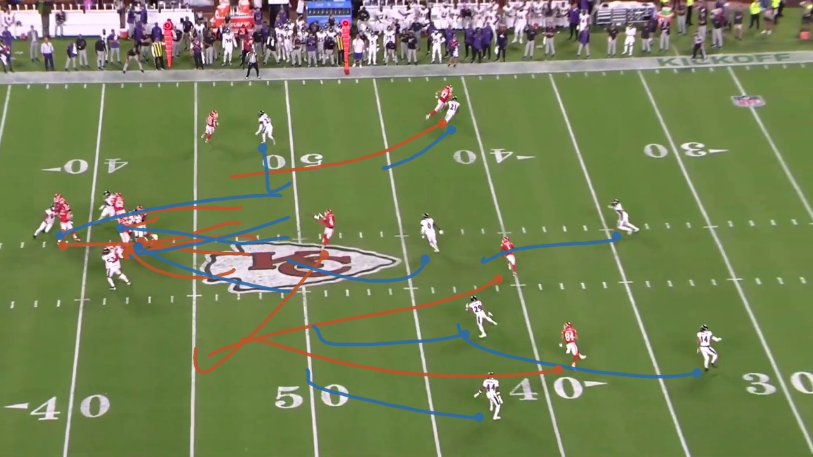
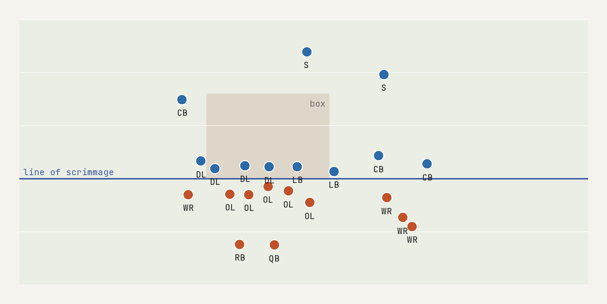

# NFLVision

**From American football video to player-tracking data, and from tracking data to live analytics.**

NFLVision takes ordinary game footage and turns every play into tracking data: the position of all 22 players in field yards, ten times per second, with team, role, speed and direction. Everything shown here was produced by the pipeline on a **public video it had never seen**, with no tracking data available for that game.

Kansas City vs Baltimore, 2024 season opener. Left: the game video with overlays re-projected from our tracks. Right: the same play from above. Bottom: metrics computed live from the tracks. [Full-resolution video (MP4)](media/live-board.mp4).

---

## What the live board shows

Tracking data is only interesting for what you can do with it. Each panel of the board is a small analysis running on the tracks, frame by frame:

| Panel | What it measures | How to read it |
|---|---|---|
| **Pocket** | Area of the convex hull formed by the five offensive linemen and the quarterback, in yd² | The pocket opens after the snap (26 yd² at its widest) and collapses as the rush gets home: 4.8 yd² at +3.5 s |
| **Pressure on the QB** | Distance from the quarterback to the nearest defender; defenders within 3 yd | A defender is within 3 yd at +2.4 s; two are by +3.2 s |
| **Receiver separation** | Distance from each receiver to the nearest defender | The ring on the top-down view marks the most open receiver at every instant |
| **Space control** | For every point of the field, which team can get there first (Voronoi tessellation of the 22 positions) | Shading on the top-down view |
| **Speed** | Fastest player right now and the fastest moment of the play | Top speed here: 19.2 mph, by a receiver on a deep route |
| **At the snap** | Defenders in the box, deep safeties (shell), receiver split, line of scrimmage | 4 in the box, a 1-high shell, 3×1 receivers |

The ball is not tracked, so the board says nothing about where the pass went. Everything else comes from the players.

---

## Architecture

The pipeline is a chain of seven stages. Each one is measured on its own, so an improvement in one stage cannot hide a loss in another.

### 1 · Plays and camera angles

All-22 footage shows every play twice: once from the sideline and once from behind the end zone. The video is first cut into shots; the camera angle comes from the geometry of the painted lines (from the end zone they run horizontally, from the sideline they slant). A play is a sideline shot followed by an end-zone shot.

The two-minute public video, split automatically: four plays, each a sideline shot (terracotta) followed by an end-zone shot (blue). The number under each shot is the share of horizontal line length that separates the two angles.

### 2 · Player detection

The only neural network in the pipeline. An **RF-DETR** detection transformer, pre-trained on everyday photos (COCO), was fine-tuned to find football players from the high All-22 camera — including the ones buried in the line — and to ignore officials and people on the sideline.

One frame before the snap: 23 boxes, players only, split by team from jersey colour. The zoom shows the line of scrimmage, where a generic detector loses players.

**Training**

| | |
|---|---|
| Base model | RF-DETR Base (transformer detector), 560 px input |
| Task | one class, *player* |
| Data | ~4,000 frames of All-22 video (training + validation), ~85,000 labelled player boxes |
| Split | training and validation on separate stretches of footage (never neighbouring frames of the same clip) |
| Schedule | 10 epochs, ≈ 2 h on a single consumer GPU (AMD Radeon RX 9070 XT, ROCm) |
| Validation | mAP@50 0.715 after one epoch → **0.775** best; precision 0.80, recall 0.75 against our labels |

Measured on held-out video, player by player: **93.4 %** of players detected (83.7 % before fine-tuning). The gain is concentrated where it matters: with three or more players around, detection goes from **57.8 % to 89.9 %**, and boxes on non-players drop to zero per frame (median).

### 3 · Field registration

To turn pixels into yards, every frame needs a **homography**: the 3×3 transform from the image of the grass to the field plane. It is built from what is painted on the field — yard lines, the two rows of hash marks and the yard numbers, which are **read** to know which line is which — and carried from frame to frame by following the camera's motion, with a correction whenever the markings are visible again. The first yard number read fixes where on the field the play is; no human input.

Left: yard lines (yellow), hash-mark rows (cyan) and the yard numbers accepted by the reader (red). Right: the same frame warped onto the field plane with the homography — the painted 40, 50 and 40 land on the right lines.

On this play the registration held for the whole sideline shot: 416 of 419 frames re-anchored to the field markings, none lost.

### 4 · Tracking in field coordinates

Detections are tracked **on the field, in yards**, not in the image, so the camera can pan and zoom without breaking the tracks. A motion model predicts where each player will be; detections are assigned to tracks with a global optimal matching; jersey colour forbids swapping a player for an opponent; a backward smoothing pass gives clean positions, speeds and directions at 10 Hz.

Three seconds into the play: every route and rush, drawn on the video from tracks that live in field yards.

### 5 · Snap, line of scrimmage and roles

The snap is found from the motion of the tracks themselves (the moment the whole field starts moving at once). The line of scrimmage comes from where the two teams meet, the offense from public play-by-play, and the **role of every player** (QB, OL, WR, TE, RB, DL, LB, CB, S) from a formation model trained on thousands of real NFL plays, which reads where each player lines up and how each one moves in the first second.

The formation at the snap, exactly as the pipeline labelled it: shotgun, 3×1 receivers, four down linemen, a 1-high shell.

---

## Results

Measured on held-out video against reference tracking, player by player and frame by frame:

| Stage | Metric | Result |
|---|---|---|
| Detection | players detected (recall per player, 2-yd matching on the field) | **93.4 %** · 89.9 % in crowds of 3+ |
| Field registration | plays registered through the whole play | **100 %** |
| Tracking | median position error | **0.56 yd** |
| | median speed error · direction error (moving players) | **0.20 yd/s · 4.8°** |
| | identity — IDF1 (one consistent ID per player) | **0.838** |
| | players covered by a track (3+ nearby) | **98.5 %** (99.1 %) |
| Teams | correct team from jersey colour | **97.2 %** |
| Snap | detected within ±0.2 s | **92 %** |
| Line of scrimmage | within 1 yd | **93 %** |
| Roles | correct role at the snap (all 22) | **85.6 %** · QB 95 % |
| Play matching | video clip matched to its play-by-play row, from yard numbers and field position | **97.4 %** |

What is still hard: keeping a single identity for each lineman through a pile-up, close-up camera shots (the registration needs to see field markings), and safeties versus linebackers, whose labels depend on the roster as much as on the play.

---

## The data

[`data/kc-bal-pass-play-tracking.csv`](data/kc-bal-pass-play-tracking.csv) is the full output of the pipeline for the play in the board: 22 players, from 1 s before the snap to 4.5 s after, at 10 Hz (1,231 rows).

| Column | Meaning |
|---|---|
| `time_from_snap_s` | seconds from the detected snap (negative = before) |
| `player` | anonymous ID: team, role at the snap and a counter (`KC-WR2`, `BAL-CB1`…) |
| `team`, `side` | KC / BAL; offense / defense |
| `role_at_snap` | QB, RB, WR, OL, DL, LB, CB, S, as assigned by the pipeline |
| `x_yd`, `y_yd` | position in yards: `x` along the field (0–120, end zones included), `y` across it (0–53.3) |
| `speed_yd_s`, `dir_deg` | speed in yards per second; direction of motion in degrees (0° = +y, clockwise) |
| `detected_this_frame` | 1 if a detection supported the position in this frame, 0 if the tracker carried it |

It is pipeline output on a video with no ground truth, shared to show the format and the level of detail — not a reference dataset.

---

## Stack

Python · PyTorch · RF-DETR · OpenCV · NumPy / SciPy · pandas · PySceneDetect · AMD ROCm. Only permissively licensed components (Apache 2.0, MIT, BSD).

## About this repository

This is a showcase: it documents what NFLVision does and how well it does it. The source code, training data and model weights are not published.

Game footage belongs to the NFL; the frames and the five-second clip shown here come from a [public YouTube upload](https://www.youtube.com/watch?v=7ERkAhvmHCo) and are used, small and short, for illustration only. Everything drawn on top of them is NFLVision output.

© 2026 Miguel A. Castro · [mtorreslanda.com](https://mtorreslanda.com)
